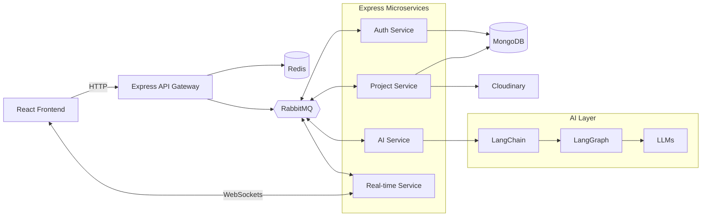

<div align="center">


# Buffalo IDE

**Code at full strength.**

An AI-powered IDE that generates code from natural language, built with React, Express, and npm workspaces.

<br />


<br />


</div>

---

> [!NOTE]
> 🚧 **Currently in Development.** Buffalo IDE is under active development. Features, APIs, and architecture may change, and the project is not yet production-ready.

## 📖 About

Buffalo IDE is an AI-powered development environment. Describe what you want to build in natural language and the IDE generates working code from scratch, rather than only enhancing or autocompleting code you have already written.

It pairs a React frontend with an Express backend organized as microservices, communicating asynchronously through RabbitMQ. AI workflows are built with LangChain and LangGraph on top of LLMs. The whole project lives in a single npm workspaces repository.

## ✨ Features

| Feature | Description | Status |
| --- | --- | --- |
| 🤖 **AI code generation** | Generate new code from natural language prompts | 🚧 In development |
| 🧠 **Agent workflows** | Multi-step AI workflows built with LangChain and LangGraph | 🚧 In development |
| ⚡ **Real-time communication** | Live updates between the IDE and backend over WebSockets | 🚧 In development |
| 🧩 **Microservice backend** | Message-driven Express services communicating via RabbitMQ | 🚧 In development |
| ☁️ **Media uploads** | Asset and media handling through Cloudinary | 🚧 In development |
| 🔐 **Sessions and caching** | Redis-backed sessions and fast data access | 🚧 In development |

<!-- VERIFY: update each status to ✅ Available as features are completed, and add features that actually exist (editor, file tree, projects, etc.). -->

## 🧰 Tech Stack

| Layer | Technologies |
| --- | --- |
| **Monorepo** | npm workspaces |
| **Frontend** | React, Tailwind CSS |
| **Backend** | Express, TypeScript |
| **Data** | MongoDB with Mongoose, Redis (sessions and caching) |
| **Messaging** | RabbitMQ |
| **Real-time** | WebSockets |
| **AI** | LLMs, LangChain, LangGraph |
| **Media** | Cloudinary |
| **Infrastructure** | Docker, Docker Compose |

## 🏗️ Architecture



<!-- VERIFY: service names, which services use Mongo/Redis/Cloudinary, and the WebSocket host service are inferred. Adjust to match the actual code. -->

## 📁 Project Structure

```text
buffalo-ide/
├── apps/          # React frontend (and backend services, if kept here)
├── packages/      # Express services and shared packages
├── assets/        # Logo and static README assets
└── package.json   # npm workspaces root
```

<!-- VERIFY: replace with the actual workspace layout from the "workspaces" field in the root package.json. -->

## 🚀 Getting Started

### Prerequisites

- Node.js and npm
- Docker and Docker Compose

### Installation

```bash
git clone <your-repository-url>
cd buffalo-ide
npm install
```

### Configuration

<!-- VERIFY: document the real environment files and variables (e.g. from .env.example). None are listed here to avoid inaccuracies. -->

Create the required environment files for MongoDB, Redis, RabbitMQ, Cloudinary, and your LLM provider as described in the repository's example env files.

### Run

```bash
# Start infrastructure (verify the Compose file path and service names)
docker compose up -d

# Run a script in a specific workspace (replace the placeholders)
npm run <script> --workspace=<workspace-name>
```

<!-- VERIFY: replace with the exact scripts defined in each workspace's package.json. -->

## 🗺️ Roadmap

- [ ] 🤖 AI code generation from natural language
- [ ] 🧠 LangGraph agent workflows
- [ ] ⚡ Real-time communication over WebSockets
- [ ] 🧩 Core microservices and message-driven communication
- [ ] ☁️ Cloudinary media uploads
- [ ] 🧪 Testing and CI/CD
- [ ] 🚢 Production deployment

<!-- VERIFY: tick items that are complete and add or remove items to match your plans. -->

## 📄 License

A license has not yet been specified for this project.

<!-- VERIFY: if a LICENSE file exists in the repository, replace this section with its name and a link. -->

---

<div align="center">

**Buffalo IDE** · Code at full strength.

</div>
